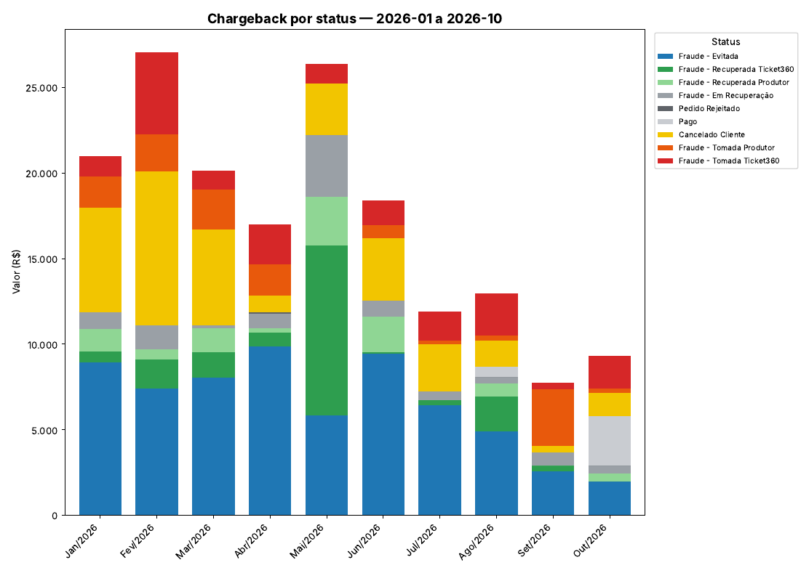
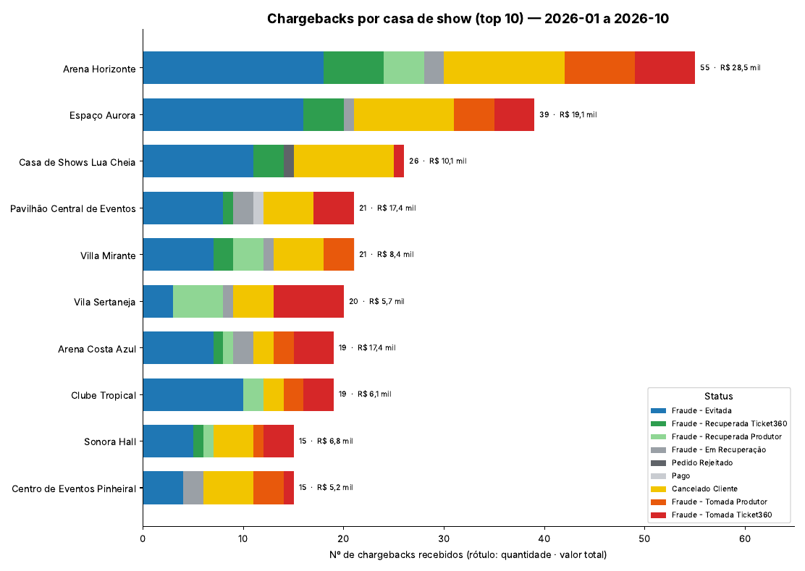

# Relatório de Chargeback

Lê a planilha de chargebacks em Excel e gera, em segundos, um relatório com:

1. **Valor de chargeback por status do pedido, mês a mês**, para qualquer período.
2. **Frequência de chargebacks por casa de show**, com o valor total de cada uma.

O resultado sai em **PDF** (para ler e compartilhar) e em **Excel** (para filtrar e conferir os números).

Pensado para uso recorrente: quem faz o relatório todo mês **não precisa saber usar o terminal**. É só dar um duplo clique, escolher a planilha e confirmar o período.

---

## Exemplo do resultado

> Os gráficos abaixo foram gerados com a planilha **fictícia** deste repositório (`EXEMPLO_CHARGEBACK_2026.xlsx`). Nenhum dado real é publicado aqui.

**Valor por status, mês a mês**



**Frequência por casa de show** (rótulo: quantidade · valor total)



As cores seguem o significado de cada status: azul e verdes para casos resolvidos a favor, cinza para o que está em andamento ou neutro, amarelo para atenção e laranja/vermelho para perdas.

| Status | Cor | Significado |
|---|---|---|
| Fraude - Evitada | Azul | Resolvido |
| Fraude - Recuperada Ticket360 | Verde | Recuperado |
| Fraude - Recuperada Produtor | Verde claro | Recuperado |
| Fraude - Em Recuperação | Cinza | Em processamento |
| Pedido Rejeitado / Pago | Cinza escuro / claro | Neutro |
| Cancelado Cliente | Amarelo | Atenção |
| Fraude - Tomada Produtor | Laranja escuro | Perda |
| Fraude - Tomada Ticket360 | Vermelho | Perda (maior preocupação) |

---

## Sumário

- [Uso sem terminal (2 cliques)](#uso-sem-terminal-2-cliques)
  - [Windows](#windows)
  - [Linux](#linux)
  - [macOS](#macos)
- [Uso pelo terminal](#uso-pelo-terminal)
- [O que o relatório gera](#o-que-o-relatório-gera)
- [Como os dados são tratados](#como-os-dados-são-tratados)
- [Personalização](#personalização)
- [Planilha de exemplo](#planilha-de-exemplo)
- [Estrutura do repositório](#estrutura-do-repositório)
- [Problemas comuns](#problemas-comuns)
- [Privacidade](#privacidade)

---

## Uso sem terminal (2 cliques)

O fluxo é o mesmo em todos os sistemas:

1. **Clique 1:** duplo clique no arquivo de execução (`Gerar Relatorio.bat` no Windows, `gerar_relatorio.sh` no Linux).
2. **Clique 2:** escolha a planilha na janela que abre e confirme o período (já vem preenchido com **janeiro do ano atual até o mês atual**; basta clicar em OK).

Ao terminar, uma mensagem informa onde os arquivos foram salvos: a pasta **`relatorios`**, criada ao lado da planilha escolhida.

### Windows

**Preparação (uma única vez):**

1. Instale o Python em <https://www.python.org/downloads/> (versão 3.10 ou mais nova).
   Na **primeira tela do instalador, marque "Add python.exe to PATH"**. Mantenha as opções padrão, inclusive *tcl/tk and IDLE*, que é o que permite abrir as janelas de escolha.
2. Baixe este repositório (**Code → Download ZIP**) e **extraia a pasta** para um lugar fixo, por exemplo `C:\Relatorio`.
   Não execute de dentro do ZIP: o Windows deixa abrir os arquivos lá, mas o programa não funciona.

**Para gerar o relatório:**

1. Duplo clique em **`Gerar Relatorio.bat`**.
2. Escolha a planilha e confirme o período.

Observações:

- Na **primeira execução** o programa instala sozinho as bibliotecas necessárias. Leva de 1 a 2 minutos, **precisa de internet** e a janela preta não deve ser fechada. Nas próximas vezes abre direto.
- Se o Windows exibir *"O Windows protegeu o computador"* (arquivo baixado da internet), clique em **Mais informações → Executar assim mesmo**. Isso acontece uma vez.
- **Dica:** clique com o botão direito em `Gerar Relatorio.bat` → **Enviar para → Área de trabalho (criar atalho)**. Daí em diante o uso mensal é: duplo clique no atalho e escolher a planilha.

### Linux

**Preparação (uma única vez):**

```bash
# Debian / Ubuntu
sudo apt install python3 python3-venv python3-tk
# Fedora:  sudo dnf install python3 python3-tkinter
# Arch:    sudo pacman -S python tk

chmod +x gerar_relatorio.sh
```

O `chmod +x` é necessário porque o bit de executável se perde ao baixar o repositório como ZIP.

**Para gerar o relatório:**

- Duplo clique em **`gerar_relatorio.sh`** no gerenciador de arquivos e escolha **Executar**. No GNOME Arquivos pode ser necessário habilitar antes: *Preferências → Comportamento → Arquivos de texto executáveis → Executar* (ou *Perguntar*). Ou:
- No terminal: `./gerar_relatorio.sh`

Na primeira execução o script cria uma pasta `venv/` com as dependências (precisa de internet).

### macOS

> Não testado em macOS. Deve funcionar com o mesmo fluxo do Linux.

Instale o Python de <https://www.python.org/downloads/> (o instalador já inclui as janelas de escolha) e, **uma única vez** no Terminal, dentro da pasta do projeto:

```bash
cp gerar_relatorio.sh gerar_relatorio.command
chmod +x gerar_relatorio.command
```

Depois é só dar duplo clique em `gerar_relatorio.command`. Na primeira vez, o macOS pode pedir confirmação: clique com o botão direito → **Abrir**.

---

## Uso pelo terminal

Para quem prefere linha de comando, ou quer automatizar. Funciona igual em Windows, Linux e macOS.

**Instalação:**

```bash
pip install -r requirements.txt
```

No Linux e no macOS recentes, use antes um ambiente virtual (`python3 -m venv venv && source venv/bin/activate`), pois o sistema pode bloquear `pip` global. No Windows, use `py -3` no lugar de `python` se o comando `python` não for reconhecido.

**Execução:**

```bash
# Ano atual, de janeiro até o mês atual
python relatorio_chargeback.py planilha.xlsx

# Período específico
python relatorio_chargeback.py planilha.xlsx --inicio 2026-03 --fim 2026-06

# Um mês só
python relatorio_chargeback.py planilha.xlsx --inicio 2026-08 --fim 2026-08

# Período que cruza anos (lê as duas abas automaticamente)
python relatorio_chargeback.py planilha.xlsx --inicio 2025-11 --fim 2026-02

# Mais casas de show no gráfico
python relatorio_chargeback.py planilha.xlsx --top 15
```

Os launchers também aceitam argumentos: `./gerar_relatorio.sh planilha.xlsx --inicio 2026-03`.

| Opção | Descrição | Padrão |
|---|---|---|
| `planilha` | Caminho do `.xlsx`. **Se omitido, abre as janelas de escolha** (modo 2 cliques). | — |
| `--inicio AAAA-MM` | Primeiro mês do período | Janeiro do ano atual |
| `--fim AAAA-MM` | Último mês do período (inclusive) | Mês atual |
| `--top N` | Quantas casas de show aparecem no gráfico | `10` |
| `--coluna-data "NOME"` | Coluna usada para definir o mês de cada chargeback | `Data Recepção` |

Exemplo usando a data da compra em vez da data de recebimento do chargeback:

```bash
python relatorio_chargeback.py planilha.xlsx --coluna-data "Data Transação"
```

---

## O que o relatório gera

Na pasta `relatorios/`, ao lado da planilha, com o período no nome (`chargeback_2026-01_2026-10.*`):

| Arquivo | Conteúdo |
|---|---|
| `.pdf` | **Página 1:** gráfico de barras empilhadas, valor por status, mês a mês<br>**Página 2:** frequência por casa de show (top N)<br>**Página 3:** tabela com os valores |
| `.xlsx` | **Aba "Chargeback por status":** status × mês, com totais<br>**Aba "Frequência por casa":** todas as casas, com a contagem por status, o total de ocorrências e o valor total |

Rodar de novo para o mesmo período **substitui** os arquivos anteriores.

---

## Como os dados são tratados

**Onde lê:** abas chamadas `Total Geral - Chargeback.<ano>` (por exemplo, `Total Geral - Chargeback.2026`). Se o período cruzar anos, lê cada ano correspondente.

**Colunas usadas:** `Valor Pré-Chargeback (R$)`, `Status Do Pedido`, `Data Recepção` e `Local`.

**Regras do relatório:**

- O **mês** de cada chargeback vem de `Data Recepção` (quando o chargeback chegou).
- O **valor** é a soma de `Valor Pré-Chargeback (R$)`.
- Linhas com data fora do período são ignoradas. É comum haver casos antigos reabertos numa aba de outro ano.
- O ranking por casa de show conta **todos** os status, inclusive "Fraude - Evitada". As cores mostram quanto da frequência virou perda.

**Limpeza automática** (a planilha é preenchida à mão e tem variações):

| Problema | O que o programa faz |
|---|---|
| Espaços, tabs ou quebras de linha sobrando em status e locais | Remove |
| Status escrito de outro jeito (`Fraude Recuperada Produtor`) | Unifica com o nome correto (`Fraude - Recuperada Produtor`) |
| Erros de digitação conhecidos em locais | Corrige pelo dicionário `CORRECOES_LOCAL` |
| Status digitado na coluna `Local` por engano | Descarta a linha **apenas do gráfico de casas** e avisa |
| Linha sem data, valor ou status válido | Ignora e avisa quantas foram |

Nomes parecidos de casas (por exemplo, o estacionamento de uma casa e a própria casa) **não** são unificados automaticamente, porque podem ser locais diferentes. Para juntá-los, use o dicionário de correções.

---

## Personalização

Tudo que pode mudar fica no **topo** do arquivo `relatorio_chargeback.py`, sem precisar mexer na lógica:

| Constante | Para que serve |
|---|---|
| `ABA_MODELO` | Padrão do nome das abas por ano |
| `COL_VALOR`, `COL_STATUS`, `COL_LOCAL`, `COL_DATA_PADRAO` | Nomes das colunas, caso a planilha mude |
| `CORRECOES_STATUS` | Variações de grafia de status → nome correto |
| `CORRECOES_LOCAL` | Erros de digitação ou nomes a unificar nos locais |
| `CORES_STATUS` | Cor de cada status. **A ordem do dicionário define a ordem das barras, da legenda e da tabela** |

Um status novo que ainda não esteja em `CORES_STATUS` aparece em cinza médio, até ser adicionado.

---

## Planilha de exemplo

`EXEMPLO_CHARGEBACK_2026.xlsx` tem a mesma estrutura da planilha real, com dados **100% fictícios** (pedidos, cartões de teste, clientes, eventos, casas de show e valores inventados). Inclui de propósito as imperfeições que o programa trata.

Para testar sem usar dados reais:

```bash
python relatorio_chargeback.py EXEMPLO_CHARGEBACK_2026.xlsx --inicio 2026-01 --fim 2026-10
```

Para recriá-la (o resultado é sempre o mesmo, a semente é fixa):

```bash
python gerar_planilha_exemplo.py
```

---

## Estrutura do repositório

```
.
├── README.md
├── relatorio_chargeback.py        # programa principal
├── gerar_planilha_exemplo.py      # gera a planilha fictícia
├── EXEMPLO_CHARGEBACK_2026.xlsx   # planilha fictícia de exemplo
├── requirements.txt               # dependências Python
├── Gerar Relatorio.bat            # duplo clique no Windows
├── gerar_relatorio.sh             # duplo clique no Linux / macOS
├── docs/                          # imagens usadas neste README
├── .gitignore                     # impede subir planilhas reais
└── .gitattributes                 # fim de linha correto dos launchers
```

---

## Problemas comuns

| Mensagem ou sintoma | Causa e solução |
|---|---|
| *"Python não foi encontrado"* (Windows) | Python não instalado, ou instalado sem "Add python.exe to PATH". Reinstale marcando a opção. |
| Janela preta abre e fecha rápido | O `.bat` pausa quando há erro. Se mesmo assim sumir, rode pelo terminal para ver a mensagem completa. |
| Demora na primeira execução | Normal: está instalando as bibliotecas (precisa de internet). |
| `PermissionError` ao salvar | O PDF ou o Excel do mesmo período está **aberto**. Feche-o e rode de novo. No Windows, arquivo aberto fica bloqueado. |
| `ModuleNotFoundError: pandas` (ou outro) | Dependências não instaladas. Rode `pip install -r requirements.txt` (no Linux, com o `venv` ativo). |
| `No module named 'tkinter'` (Linux) | Instale `python3-tk`. Alternativa: informe a planilha e o período por argumentos, que dispensa as janelas. |
| `Aviso: aba 'Total Geral - Chargeback.AAAA' não existe` / `nenhuma aba do período foi encontrada` | O nome da aba mudou, ou o ano não existe na planilha. O aviso ignora só aquele ano; o erro significa que nenhuma aba do período foi achada. Ajuste `ABA_MODELO`. |
| `não tem a(s) coluna(s): [...]` | Um cabeçalho foi renomeado. Ajuste as constantes `COL_*`. |
| `nenhum chargeback encontrado nesse período` | Não há linhas com `Data Recepção` no período informado. Confira o intervalo. |
| `N linha(s) ignoradas` | Linhas com data, valor ou status vazio ou inválido. Corrija na planilha, se forem relevantes. |
| Uma casa aparece duas vezes no gráfico | Nomes escritos de forma diferente. Una em `CORRECOES_LOCAL`. |
| Uma barra cinza que não deveria existir | Status novo sem cor definida. Adicione em `CORES_STATUS`. |

---

## Privacidade

A planilha real contém dados sensíveis (cartões truncados, nomes de clientes, números de pedido). Por isso o `.gitignore` bloqueia `*.xlsx`, `*.xlsm`, `*.csv` e a pasta `relatorios/`, liberando apenas a planilha de exemplo.

**Nunca publique a planilha real nem os relatórios gerados a partir dela.** Se algum dia precisar compartilhar um caso de teste, gere a versão fictícia com `gerar_planilha_exemplo.py`.
